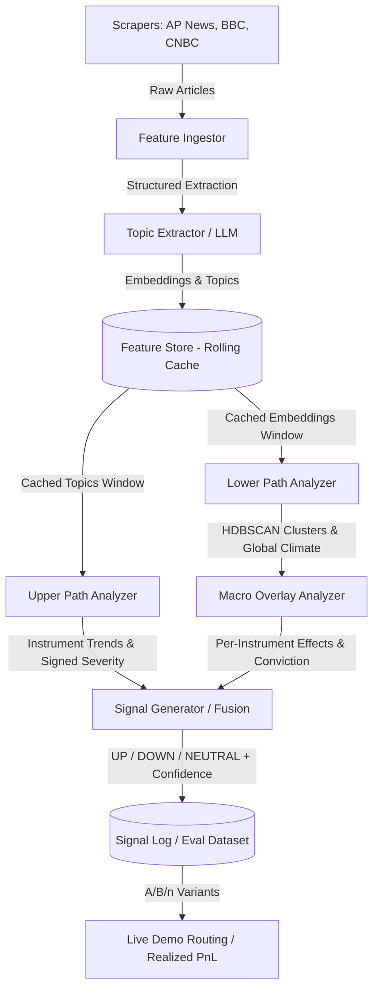

# AGH Analytica NLP Predictor
### **Automated financial news analysis system**


<div align="left">


</div>


## Project developed within the [AGH Analytica Student Research Group](https://github.com/AGHAnalytica) at [AGH University of Krakow](https://www.agh.edu.pl/) (2026).

## Setup & Installation

The NLP Predictor pipeline uses `pyproject.toml` for dependency management and the ultra-fast `uv` package manager.

### Prerequisites
- **Python** (v3.11+)
- **uv** - follow instructions at [official Astral page](https://docs.astral.sh/uv/getting-started/)
- API key for [OpenAI API](https://platform.openai.com/api-keys)

### Installation Steps

1. **Clone the repository:**
```bash
   cd <your/working/directory>
   git clone https://github.com/AGHAnalytica/NLP_predictor.git
   cd NLP_predictor
```
2. Create `.env` file
In repo's directory create a file named `.env` and fill it with the following content
```
OPENAI_API_KEY=your_api_key_goes_here
```

3. Install all needed dependencies and create virtual environment using `uv`

```bash
   uv sync
```

4. **Run the main pipeline:**

```bash
   uv run main
```

---

## Architecture

The NLP Predictor pipeline processes financial news streams through a modular **Dual-Path Architecture**, separating micro-level instrument sentiment from macro-level narrative context, before deterministically fusing them into trading signals:



---

## Data Flow Pipeline
1. **Scraping (`nlp_predictor.scraping`)**:
   - Fetches live feeds (AP News, BBC, CNBC) and historical dumps.
   - Deduplicates and normalizes article metadata, publication timestamps, and content.
2. **Feature Ingestion & Topic Extraction (`nlp_predictor.preprocessing`)**:
   - Uses OpenAI Structured Outputs to extract fine-grained topics, financial instruments, and sentiments.
   - Caches embeddings and topics in an append-only rolling `FeatureStore` (parquet-backed), ensuring expensive LLM calls occur only once per article.
3. **Dual-Path Analysis**:
   - **Upper Path (`nlp_predictor.upper_path`)**: Groups topics by traded instrument and computes directional severity using the DCIM model or A/B testing variants. Generates instrument trend narratives.
   - **Lower Path (`nlp_predictor.lower_path`)**: Clusters topic embeddings via HDBSCAN to identify overarching macroeconomic trends. Computes macro severity and market climate.
   - **Macro Overlay (`nlp_predictor.lower_path.macro_overlay`)**: Translates the macro climate into per-instrument effects (`tailwind`, `headwind`, `neutral`) with conviction weighting.
4. **Deterministic Signal Fusion (`nlp_predictor.signal`)**:
   - Fuses Upper Path directional severity (determining `UP` / `DOWN` / `NEUTRAL`) with Lower Path macro context.
   - Modulates trade confidence and can veto weak contrarian signals fighting the macro climate.
   - Outputs auditable signals with human-readable rationales to `SignalLog`.

---

## DCIM Model & Scoring

The **Directional Confirmed Impact Model (DCIM)** evaluates signed instrument sentiment $S \in [-1.0, 1.0]$ across a rolling window of news topics through 5 mathematical phases:

### Phase 1: Exponential Time Decay & Raw Impact
Decays older articles based on their age $\Delta t$ relative to the current tick timestamp:
$$w_{\text{decay}} = 2^{-\frac{\Delta t}{\tau}}$$
where $\tau$ is `half_life_hours`. The per-article raw impact is:
$$I_{\text{raw}} = \text{source\_weight} \cdot \text{sentiment} \cdot w_{\text{decay}}$$

### Phase 2: Echo-Chamber Penalty
Mitigates repetitive coverage from the same media publisher pushing in the same direction. For the $k$-th article from source $s$:
$$p_k = 1.0 + \beta \cdot k, \quad k \in \{0, 1, 2, \dots\}$$
$$\text{Impact}_s = \sum_{k} \frac{I_{\text{raw}, k}}{p_k}$$
Diminishing returns prevent a single publisher from dominating the narrative.

### Phase 3: Cross-Source Consensus Bonus
Rewards broad agreement across $U$ independent news publishers. If $U \ge 2$:
$$C = 1.0 + \gamma \cdot \frac{U_{\text{agree}}}{U}$$
where $U_{\text{agree}}$ is the count of sources whose net sentiment agrees with the overall directional sign.

### Phase 4: Velocity Multiplier
Detects sudden surges in breaking news coverage:
$$V = \frac{N_{\text{recent}}}{N_{\text{total}} + 1.0}, \quad M_V = 1.0 + \delta \cdot V$$
where $N_{\text{recent}}$ is the number of articles published within `recent_window_hours`.

### Phase 5: Scaling & Hyperbolic Tangent Squash
Combines all phases and applies a smooth bounded activation:
$$z = \kappa \cdot C \cdot M_V \cdot \sum_{s} \text{Impact}_s$$
$$S_{\text{DCIM}} = \tanh(z) \in [-1.0, 1.0]$$
The resulting signed score serves as the primary quantitative driver for direction and base confidence in signal generation.

---

## Documentation Generation

Technical documentation for the NLP engine is generated automatically directly from the Python docstrings using **Sphinx**.

Here is the step-by-step guide on how to build the latest HTML documentation:

### Step 1: Activate the environment

Ensure your virtual environment is active (see steps 3 and 4 in the Setup section). All required documentation packages (like Sphinx) are already installed via `uv sync`.

### Step 2: Navigate to the docs directory

Move to the folder containing the Sphinx `Makefile`:

```bash
cd docs

```

### Step 3: Update source files (if code structure changed)

If you have added new `.py` files or changed the directory structure in `src/nlp_predictor`, rebuild the `.rst` source files:

```bash
sphinx-apidoc -f -o source ../src/nlp_predictor
```

### Step 4: Build the HTML documentation

Generate the web pages using the `make` command:

* **Linux / macOS:**

```bash
  make html
```

* **Windows:**

```cmd
  make.bat html
```

### Step 5: View the documentation

Once the build succeeds, the generated files will be located in:
`docs/build/html/`

Open the **`index.html`** file from that directory in any web browser to view the latest documentation.

```
    file:///$YOUR_PATH$/NLP_predictor/docs/build/html/index.html
```

---

## Contributors
| Name | GitHub | Role |
| :--- | :--- | :--- |
| **Norbert Jarzmik** | [](https://github.com/njarzmik) [](https://pl.linkedin.com/in/norbert-jarzmik-38802431b) | Team Leader / Researcher / Python Developer|
| **Konrad Zatorski** | [](https://github.com/K0D1Z) [](https://www.linkedin.com/in/konrad-zatorski/) | Python Developer / Researcher / Upper & Lower Path Developer|
| **Rafał Mazur** | [](https://github.com/Rafek731) []()| Python Developer / Researcher|
| **Filip Wojtczak** | [](https://github.com/imnotbruhwe) [](https://www.linkedin.com/in/filip-wojtczak/)| Python Developer / Researcher / Scrapper Developer|
| **Wojciech Kocemba** | [](https://github.com/Operative88) []()| Python Developer / Researcher / Scrapper Developer|
| **Filip Kontek** | [](https://github.com/napewnoniefixu) []()| Python Developer / Researcher / Upper Path Developer|
| **Olga Ehrenfeld** | []() []()| Python Developer / Researcher|
| **Bartek Tasak** | []() []()| Python Developer / Researcher|
| **Andrii-Dmytro Kilnytskyi** | []() []()| Python Developer / Researcher|
