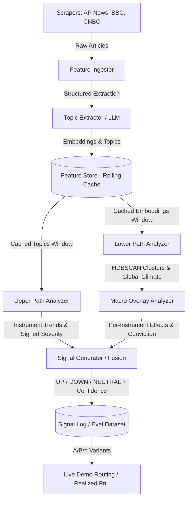

# AGH Analytica NLP Predictor
### **Automated financial news analysis & quantitative signal generation system**


<div align="left">


</div>

> [!NOTE]
> **AI-Generated Documentation Notice (`Gemini Argon`):**
> This comprehensive developer guide and architectural reference was generated with the assistance of **Gemini Argon**. Because the codebase is large and actively evolving, minor inaccuracies or outdated details may occasionally appear in this document. Always treat the typed Pydantic schemas in `src/nlp_predictor/config/` and the YAML files in `configs/` as the authoritative source of truth.

## Project developed within the [AGH Analytica Student Research Group](https://github.com/AGHAnalytica) at [AGH University of Krakow](https://www.agh.edu.pl/) (2026).

---

## Table of Contents
1. [Setup & Installation](#setup--installation)
2. [High-Level Architecture & Data Flow](#architecture)
3. [Complete Repository & Module Map (What Does What)](#complete-repository--module-map)
4. [Configuration System (`configs/*.yaml`)](#configuration-system)
5. [CLI Scripts & Execution Cookbook (How to Run Everything)](#cli-scripts--execution-cookbook)
6. [How to Extend the Pipeline (Scrapers & Severity Models)](#how-to-extend-the-pipeline)
7. [DCIM Mathematical Model & Scoring](#dcim-model--scoring)
8. [Testing, Linting & Documentation Generation](#testing-linting--documentation-generation)
9. [Contributors](#contributors)

---

## Setup & Installation

The NLP Predictor pipeline uses `pyproject.toml` for dependency management and the `uv` package manager.

### Prerequisites
- **Python** (v3.11+)
- **uv** — follow instructions at the [official Astral page](https://docs.astral.sh/uv/getting-started/)
- API key for [OpenAI API](https://platform.openai.com/api-keys) (and optionally Alpaca / Xfinlink keys for historical data acquisition)

### Installation Steps

1. **Clone the repository:**
```bash
cd <your/working/directory>
git clone https://github.com/AGHAnalytica/NLP_predictor.git
cd NLP_predictor
```

2. **Create `.env` file:**
Copy `.env.example` to `.env` in the repository root and fill in your credentials:
```bash
cp .env.example .env
```
```ini
OPENAI_API_KEY=your_openai_api_key_here
ALPACA_API_KEY_ID=your_alpaca_key_id_here
ALPACA_API_SECRET_KEY=your_alpaca_secret_key_here
XFINLINK_API_KEY=your_xfinlink_api_key_here
```

3. **Install dependencies and create virtual environment using `uv`:**
```bash
uv sync
```
*(Optional: to install `yfinance` for Yahoo Finance price downloads, run `uv sync --extra backtest`)*

4. **Run the main live-tick pipeline:**
```bash
uv run main
```

---

## Architecture

The NLP Predictor pipeline processes financial news streams through a modular **Dual-Path Architecture**, separating micro-level instrument sentiment from macro-level narrative context, before deterministically fusing them into trading signals:



### Data Flow Pipeline (4 Groups)
1. **Group 1 — Scraping & Preprocessing (`nlp_predictor.scraping`, `nlp_predictor.preprocessing.clean_data`)**:
   - Fetches live RSS/HTML feeds (AP News, BBC, CNBC) or historical archives.
   - Extracts clean article text (`trafilatura` or fast regex fragment stripping), normalizes timestamps to UTC, and generates deterministic SHA-256 content hashes (`doc_hash`) for `O(1)` deduplication.
2. **Group 2 — Feature Ingestion & Rolling Cache (`nlp_predictor.preprocessing`)**:
   - `TopicExtractor` uses OpenAI Structured Outputs (`ExtractedTopics`) to extract self-contained market-moving events from unseen articles.
   - `FeatureIngestor` computes topic embeddings (`LowerPathAnalyzer.generate_embeddings_batch`) and instrument sentiment mappings (`UpperPathAnalyzer.map_topics`) **once per unique `doc_hash`** and stores them in `FeatureStore` (`data/feature_store/topic_features.parquet`).
3. **Group 3 & 4 — Dual-Path Analysis (`nlp_predictor.upper_path`, `nlp_predictor.lower_path`)**:
   - **Upper Path (`UpperPathAnalyzer`)**: Explodes cached topic impacts per instrument and evaluates signed severity `S` in `[-1.0, 1.0]` across all configured A/B/n severity variants (`baseline`, `dcim`, `abnormal_volume`) **without repeating LLM calls**.
   - **Lower Path (`LowerPathAnalyzer` & `MacroOverlayAnalyzer`)**: Clusters topic embeddings via `HDBSCAN` to discover global macro narratives, computes cluster intensity, and classifies each instrument's macro climate exposure (`tailwind`, `headwind`, `neutral`).
4. **Signal Fusion & Evaluation Logging (`nlp_predictor.signal`, `nlp_predictor.tick`)**:
   - `SignalGenerator` deterministically fuses Upper Path severity `S` with Lower Path macro alignment/conflict to emit `UP`, `DOWN`, or `NEUTRAL` signals with calibrated confidence in `[0.0, 1.0]` and human-readable audit rationales.
   - `TickRunner` orchestrates a full 15-minute evaluation tick across all configured variants in `configs/severity.yaml` and appends results to `SignalLog` (`data/signal_log/signals_log.parquet`).

---

## Complete Repository & Module Map

Below is the complete guide to every package, file, class, and key method in the repository so you always know where to look:

```text
NLP_predictor/
├── configs/                        # All YAML configuration files (single source of truth)
│   ├── paths.yaml                  # Input, output, log, cache, and historical dataset paths
│   ├── hyperparameters.yaml        # OpenAI models, scraping, upper/lower path, windows, signal params
│   ├── severity.yaml               # A/B/n severity model variants evaluated on each tick
│   └── backtesting.yaml            # Backtest date ranges, macro ETFs, Alpaca/Xfinlink/filtering settings
├── src/nlp_predictor/
│   ├── main.py                     # Entry point (`uv run main`): Scrape -> Ingest -> TickRunner
│   ├── config/                     # Typed Pydantic models loading `configs/*.yaml` into `config`
│   ├── core/                       # Shared base classes, math models, Parquet I/O, and logging
│   │   ├── base_analyzer.py        # BaseAnalyzer (OpenAI retries, _parallel_map, save_trends)
│   │   ├── severity_models.py      # Pure math functions: severity_baseline, severity_dcim, severity_abnormal_volume
│   │   ├── parquet_io.py           # Shared Parquet & JSON list column serialization helpers
│   │   └── logging_config.py       # setup_logging() for console + daily rotating file logs
│   ├── scraping/                   # Live news scrapers
│   │   ├── base_scraper.py         # Abstract BaseScraper (RSS pipeline, async HTTP, deduplication)
│   │   ├── apnews_scraper.py       # APNewsScraper (HTML hub discovery + concurrent article extraction)
│   │   ├── bbc_scraper.py          # BBCScraper (RSS feed pipeline)
│   │   ├── cnbc_scraper.py         # CNBCScraper (RSS feed pipeline, filters out CNBC Pro)
│   │   └── scrape_runner.py        # run_real_scrapers() orchestrator
│   ├── preprocessing/              # Cleaning, LLM topic extraction, and rolling FeatureStore
│   │   ├── clean_data.py           # clean_html_content, strip_html_fragments, generate_doc_hash, normalize_date_to_utc
│   │   ├── topic.py                # Pydantic schemas: ExtractedTopic, ExtractedTopics
│   │   ├── topic_extractor.py      # TopicExtractor.extract_topics(articles_df)
│   │   ├── feature_store.py        # FeatureStore (load, add, window, prune, to_instrument_frame)
│   │   └── feature_ingestor.py     # FeatureIngestor.ingest(articles_df)
│   ├── upper_path/                 # Micro/Instrument-specific path (never imports lower_path)
│   │   ├── models.py               # Pydantic schemas: TickerImpact, InstrumentMapping, InstrumentTrend
│   │   └── upper_path_analyzer.py  # UpperPathAnalyzer (map_topics, score_variants, generate_variant_trends, process_data)
│   ├── lower_path/                 # Macro/Global clustering path (never imports upper_path)
│   │   ├── global_trend.py         # Pydantic schema: GlobalTrend
│   │   ├── lower_path_analyzer.py  # LowerPathAnalyzer (generate_embeddings_batch, process_data with HDBSCAN)
│   │   └── macro_overlay.py        # MacroOverlayAnalyzer.build(global_trends_df) -> MacroOverlay
│   ├── signal/                     # Deterministic fusion & evaluation log
│   │   ├── signal_generator.py     # SignalGenerator.generate(instrument_trends_df, global_trends_df, macro_overlay, now)
│   │   └── signal_log.py           # SignalLog (load, append)
│   ├── tick/                       # Single-tick multi-variant orchestrator
│   │   └── tick_runner.py          # TickRunner.run(now)
│   ├── backtesting/                # Historical data acquisition & cleaning for backtesting
│   │   └── data/
│   │       ├── alpaca_news.py      # AlpacaNewsFetcher.fetch() -> Hive-partitioned Parquet news
│   │       ├── clean_news.py       # filter_historical_news(), clean_historical_news(), spam/macro/ticker filters
│   │       ├── price_fetcher.py    # YahooPriceFetcher.fetch_tickers() -> Daily OHLCV Parquet cache
│   │       └── xfinlink_client.py  # XfinlinkClient -> Survivorship-free index rosters, fundamentals, metrics, prices
│   └── prompts/                    # Centralized LLM prompt dictionary (`PROMPTS`)
├── scripts/                        # Standalone CLI utilities and research probes
│   ├── dump_xfinlink_data.py       # CLI to download point-in-time constituents, fundamentals, metrics & prices
│   ├── filter_historical_news.py   # CLI to filter raw Alpaca news (removes 80%+ spam/noise before LLM calls)
│   ├── run_large_test.py           # End-to-end pipeline run on `articles_sample_large.csv`
│   ├── quantify_signal_source.py   # Shapley R^2 variance decomposition & elasticity of DCIM severity
│   └── probe_macro_mapping.py      # Evaluates LLM accuracy on macro climate -> instrument effect mapping
└── tests/                          # 100% offline, deterministic unit test suite (107 tests)
```

---

## Configuration System

All paths, hyperparameters, severity variants, and backtesting settings live in `configs/*.yaml` and are validated at import time by Pydantic models in `src/nlp_predictor/config/`.

Always access configuration via typed attributes on `config`:
```python
from nlp_predictor.config import config

# Paths (automatically resolved to absolute pathlib.Path objects relative to REPO_ROOT)
instruments_csv = config.paths.input.instruments
filtered_news = config.paths.historical.news_filtered
xfinlink_dir = config.paths.historical.xfinlink

# Hyperparameters
llm_model = config.hyperparams.models.llm
half_life = config.hyperparams.upper_path.dcim.half_life_hours
min_cluster = config.hyperparams.lower_path.min_cluster_size

# Severity variants list for A/B/n evaluation
variants = config.severity.variants_list

# Backtesting settings
start_date = config.backtesting.timeframe.start_date
macro_etfs = config.backtesting.data.macro_tickers
```

---

## CLI Scripts & Execution Cookbook

### 1. Run a Complete Live Tick (`main.py`)
Scrapes new articles from CNBC, AP News, and BBC, extracts and caches features for unseen `doc_hash` entries in `FeatureStore`, scores all severity variants in `configs/severity.yaml`, computes the shared macro climate, and appends signals to `data/signal_log/signals_log.parquet`:
```bash
uv run main
```

### 2. Run the End-to-End Sample Pipeline (`scripts/run_large_test.py`)
Runs `TopicExtractor` → `UpperPathAnalyzer` → `LowerPathAnalyzer` → `SignalGenerator` on `data/scraping/articles_sample_large.csv` and writes CSV reports to `data/test_results/*_large.csv`:
```bash
uv run python scripts/run_large_test.py
```

### 3. Filter Historical Alpaca News for Backtesting (`scripts/filter_historical_news.py`)
Filters raw partitioned Alpaca news (`data/historical/alpaca_news_partitioned`) by removing automated scanner digests, short snippets (< 200 chars), irrelevant non-universe tickers, and duplicate wire syndications, saving the clean dataset to `data/historical/alpaca_news_filtered.parquet`:
```bash
# Run with default paths from configs/paths.yaml and configs/backtesting.yaml
uv run python scripts/filter_historical_news.py

# Or customize date range and minimum article length:
uv run python scripts/filter_historical_news.py \
  --start-date 2020-01-01 \
  --end-date 2025-12-31 \
  --min-length 200
```

### 4. Download Point-in-Time Market & Fundamental Data (`scripts/dump_xfinlink_data.py`)
Downloads survivorship-bias-free S&P 500 / Nasdaq 100 / DJIA constituent rosters, index addition/removal events, as-reported SEC fundamentals, valuation metrics, insider trades, 13F holdings, and daily OHLCV prices into `data/historical/xfinlink/`. Automatically skips already-downloaded files (`--skip-existing` is enabled by default):
```bash
# Resume or run full dump across all configured indices
uv run python scripts/dump_xfinlink_data.py --dump-everything

# Download only specific tickers or limit count for quick testing
uv run python scripts/dump_xfinlink_data.py --tickers AAPL,MSFT,NVDA --no-include-holdings
```

### 5. Download Historical News from Alpaca API (`alpaca_news.py`)
Streams historical news from the Alpaca News API into Hive-partitioned Parquet files (`year=YYYY/month=MM/batch_*.parquet`):
```bash
uv run python -m nlp_predictor.backtesting.data.alpaca_news
```

### 6. Download Historical ETF / Market Prices from Yahoo Finance (`price_fetcher.py`)
Downloads daily OHLCV bars for all macro ETFs configured in `configs/backtesting.yaml` into `data/historical/market_prices/`:
```bash
uv run python -m nlp_predictor.backtesting.data.price_fetcher
```

### 7. Run Diagnostic & Research Probes
```bash
# Quantify how much of DCIM severity is driven by article count vs sentiment/weight/recency
uv run python scripts/quantify_signal_source.py

# Probe LLM accuracy on mapping macro climates to instrument tailwinds/headwinds (Safe Havens vs Risk Assets)
uv run python scripts/probe_macro_mapping.py
```

### 8. Python API Quick Reference (Using Components in Code)
Every pipeline component provides a `@classmethod def build_default(cls)` factory that wires default configuration paths and collaborators:
```python
from datetime import UTC, datetime
import pandas as pd

from nlp_predictor.preprocessing import FeatureIngestor, FeatureStore
from nlp_predictor.tick import TickRunner

# 1. Ingest new articles into the rolling Parquet FeatureStore
ingestor = FeatureIngestor.build_default()
articles_df = pd.read_csv("data/scraping/articles_sample.csv")
num_cached = ingestor.ingest(articles_df, now=datetime.now(UTC))

# 2. Run a multi-variant evaluation tick at any reference timestamp `now`
runner = TickRunner.build_default()
signals_df = runner.run(now=datetime.now(UTC))

# 3. Inspect cached features or logged signals
store_df = FeatureStore().load()
```

---

## How to Extend the Pipeline

### Adding a New Scraper (`src/nlp_predictor/scraping/`)
Subclass `BaseScraper` and implement `run(self) -> pd.DataFrame`:
- **For RSS feeds**: Call `self._run_rss_pipeline(rss_feeds=..., source_name="...", skip_url=...)` (see `BBCScraper` or `CNBCScraper` — only ~25 lines of code).
- **For HTML hubs**: Fetch links, call `asyncio.run(self.fetch_urls_concurrently(urls))`, and pass each page to `self.process_article(...)` (see `APNewsScraper`).
- **For Social Media / Wire APIs / Plain Text**: Pass raw text directly to `self.process_text_item(source=..., url=..., raw_title=..., raw_date=..., raw_text=...)` and customize `min_content_length` in `super().__init__(min_content_length=30)`.

### Adding a New Severity Variant (`configs/severity.yaml`)
To test a new hyperparameter combination or window length in the A/B/n tick loop, simply add an entry under `severity.variants` in `configs/severity.yaml` — `TickRunner` will automatically evaluate and log it on every tick.

---

## DCIM Model & Scoring

The **Directional Confirmed Impact Model (DCIM)** evaluates signed instrument sentiment $S \in [-1.0, 1.0]$ across a rolling window of news topics through 5 mathematical phases:

### Phase 1: Exponential Time Decay & Raw Impact
Decays older articles based on their age $\Delta t$ (in hours) relative to the current tick timestamp, where $\tau$ is `half_life_hours`, $w_i$ is `source_weight`, and $s_i$ is `sentiment`:

$$
w_{\text{decay}, i} = 2^{-\Delta t_i / \tau}
$$

$$
I_{\text{raw}, i} = w_i \cdot s_i \cdot w_{\text{decay}, i}
$$

### Phase 2: Echo-Chamber Penalty
Mitigates repetitive coverage from the same media publisher pushing in the same direction. For the $k$-th same-sign article ($k \in \{0, 1, 2, \dots\}$) from publisher $s$:

$$
p_k = 1 + \beta \cdot k
$$

$$
I_{\text{source}, s} = \sum_{k} \frac{I_{\text{raw}, k}}{1 + \beta \cdot k}
$$

Diminishing returns prevent a single publisher from dominating the narrative.

### Phase 3: Cross-Source Consensus Bonus
Rewards broad agreement across $U$ independent news publishers. When $U \ge 2$:

$$
C = 1 + \gamma \cdot \frac{U_{\text{agree}}}{U}
$$

where $U_{\text{agree}}$ is the count of distinct sources whose net impact agrees with the overall directional sign.

### Phase 4: Velocity Multiplier
Detects sudden surges in breaking news coverage within `recent_window_hours`:

$$
V = \frac{N_{\text{recent}}}{N_{\text{total}} + 1}, \quad M_V = 1 + \delta \cdot V
$$

### Phase 5: Scaling & Hyperbolic Tangent Squash
Combines all phases and applies a smooth bounded activation in $[-1.0, 1.0]$:

$$
S_{\text{DCIM}} = \tanh\!\left(\kappa \cdot C \cdot M_V \cdot \sum_{s} I_{\text{source}, s}\right)
$$

The resulting signed score $S_{\text{DCIM}}$ serves as the primary quantitative driver for signal direction and base confidence:

$$
\text{confidence} = \operatorname{clip}\!\left(|S_{\text{DCIM}}| \cdot \max\!\left(0,\, 1 + \alpha_{\text{align}} c_{\text{agree}} - \alpha_{\text{conflict}} c_{\text{conflict}}\right),\, 0,\, 1\right)
$$

---

## Testing, Linting & Documentation Generation

Before opening a Pull Request, run all mandatory verification checks via `uv`:

```bash
# 1. Auto-format code and docstrings (88 chars max line length)
uv run ruff format src tests scripts

# 2. Run linter checks
uv run ruff check src tests scripts

# 3. Run the offline unit test suite
uv run pytest --no-cov

# 4. Build Sphinx HTML documentation
uv run sphinx-build -b html -E docs/source docs/build/html
```

Once the Sphinx build succeeds, open `docs/build/html/index.html` in any browser to view the full API reference.

---

## Contributors
| Name | GitHub | Role |
| :--- | :--- | :--- |
| **Norbert Jarzmik** | [](https://github.com/njarzmik) [](https://pl.linkedin.com/in/norbert-jarzmik-38802431b) | Team Leader / Researcher / Python Developer|
| **Konrad Zatorski** | [](https://github.com/K0D1Z) [](https://www.linkedin.com/in/konrad-zatorski/) | Python Developer / Researcher / Upper & Lower Path Developer|
| **Rafał Mazur** | [](https://github.com/Rafek731) []()| Python Developer / Researcher|
| **Filip Wojtczak** | [](https://github.com/imnotbruhwe) [](https://www.linkedin.com/in/filip-wojtczak/)| Python Developer / Researcher / Scrapper Developer|
| **Wojciech Kocemba** | [](https://github.com/Operative88) []()| Python Developer / Researcher / Scrapper Developer|
| **Filip Kontek** | [](https://github.com/napewnoniefixu) []()| Python Developer / Researcher / Upper Path Developer|
| **Olga Ehrenfeld** | []() []()| Python Developer / Researcher|
| **Bartek Tasak** | []() []()| Python Developer / Researcher|
| **Andrii-Dmytro Kilnytskyi** | []() []()| Python Developer / Researcher|
